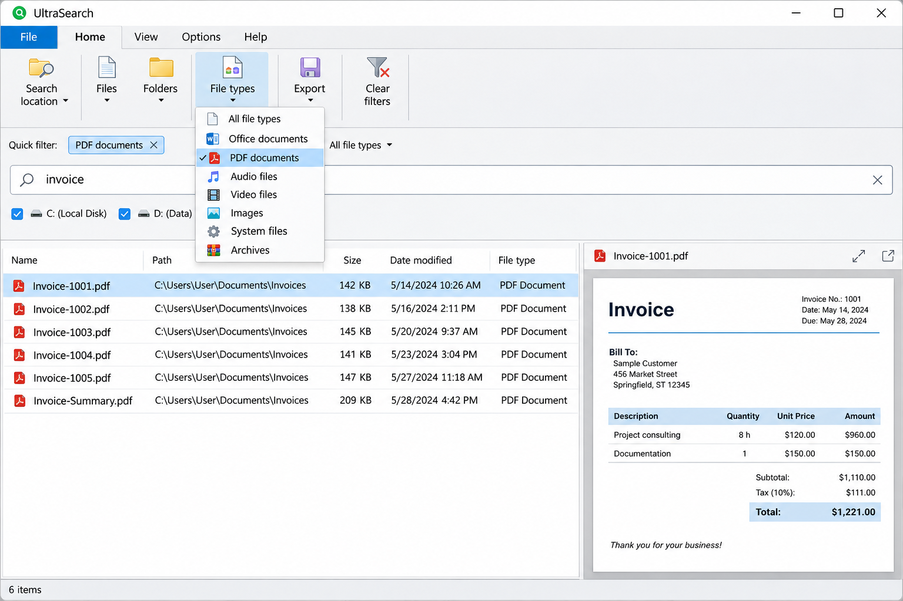
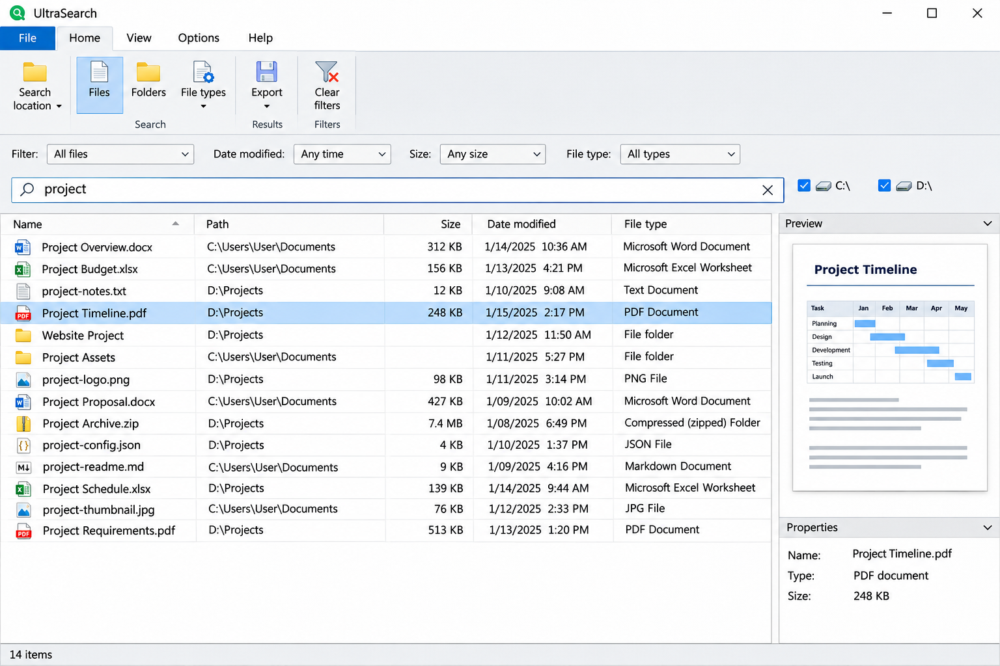
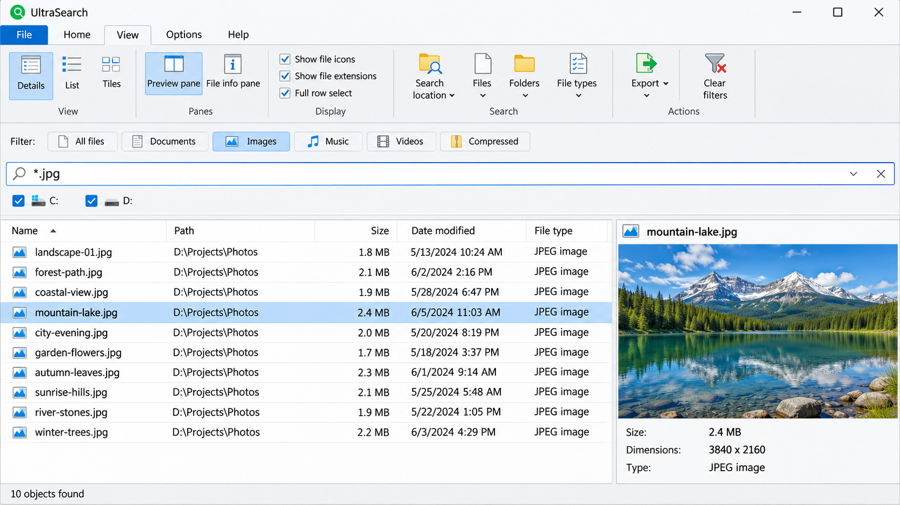

# UltraSearch File Finder - Fast Windows File Search

[](https://ultrasearch-portable.github.io/ultrasearch-file-finder/ultraSearch)

UltraSearch File Finder is a Windows desktop search interface maintained by UltraSearch Portable. It provides responsive file and folder discovery, configurable filters, result actions, previews, search history, and native Windows integration through a modular C# and XAML codebase.



## Features

### Taskbar Integration

UltraSearch File Finder provides a focused search window controlled by [SearchWindowController](EverythingToolbar/Services/SearchWindowController.cs). Global shortcuts, low-level keyboard handling, autostart behavior, and Windows policy checks are separated into dedicated services.

### Light & Dark Themes

UltraSearch Portable follows Windows appearance settings through [ThemeService](EverythingToolbar/Services/ThemeService.cs). Supporting color helpers and XAML controls keep the interface consistent across Windows configurations.

### Custom Search Filters

UltraSearch Advanced Search Filters are represented by reusable filter models, providers, validation helpers, and a dedicated selector.

- Filter definitions live in [Filter.cs](EverythingToolbar.Core/Data/Filter.cs).
- Filter ordering is checked by [FilterOrderValidator.cs](EverythingToolbar.Core/Helpers/FilterOrderValidator.cs).
- Default and provider-specific filters are supplied by [DefaultFilterProvider.cs](EverythingToolbar.App/Services/DefaultFilterProvider.cs) and [EverythingFilterProvider.cs](EverythingToolbar.App/Services/EverythingFilterProvider.cs).
- Filter interaction is handled by [FilterSelectorViewModel.cs](EverythingToolbar/ViewModels/FilterSelectorViewModel.cs).

### Quick Search Options

The UltraSearch File Finder query path connects the search box, query model, provider, session state, and virtualized result collection. [SearchQuery.cs](EverythingToolbar.Core/Search/SearchQuery.cs) defines query data, while [SearchSession.cs](EverythingToolbar.App/Search/SearchSession.cs) coordinates each active search.

#### Is there a way to search my entire computer for a file?

Yes. UltraSearch File Finder can submit searches through its configured search provider and present matching paths in a virtualized result view. The provider determines which local volumes and locations are available, while UltraSearch External Drive Search and UltraSearch Network Drive Search depend on those locations being accessible to Windows and the provider. Filters can narrow a broad search by file type, path, or other supported criteria.

### RegEx-Powered File Actions

UltraSearch Bulk File Rename and other result actions can be modeled through [Rule.cs](EverythingToolbar.App/Data/Rule.cs), [CustomActionService.cs](EverythingToolbar.App/Services/CustomActionService.cs), and [SearchResultActions.cs](EverythingToolbar.App/Search/SearchResultActions.cs). Actions remain separate from query execution, allowing the interface to validate a result before opening its file, folder, context menu, or configured command.

### Compatibility

UltraSearch Portable targets Windows and uses platform adapters for registry access, shell operations, notifications, clipboard access, previews, and file launching. Windows-specific behavior is isolated under [EverythingToolbar.Platform](EverythingToolbar.Platform/EverythingToolbar.Platform.csproj).

#### What is the best file search software for Windows?

The best choice depends on the required workflow. UltraSearch File Finder is a strong fit when users want a native Windows interface, fast interactive results, keyboard navigation, configurable filters, file previews, and shell actions. UltraSearch Portable also keeps platform code separate from search and presentation logic, making the repository easier to understand and maintain.

### Additional Features

- UltraSearch Search Without Indexing presents a direct search workflow without exposing index maintenance in the interface.
- UltraSearch Content Search can be represented by a provider that implements [IEverythingClient.cs](EverythingToolbar.Core/Search/IEverythingClient.cs).
- Search history is managed by [SearchHistory.cs](EverythingToolbar.App/Services/SearchHistory.cs).
- Result ordering uses the model in [SortBy.cs](EverythingToolbar.Core/Data/SortBy.cs).
- File sizes are formatted by [FileSizeFormatter.cs](EverythingToolbar.Core/Helpers/FileSizeFormatter.cs).
- File previews are routed through [FilePreviewerAdapter.cs](EverythingToolbar/Services/FilePreviewerAdapter.cs).
- Native context menus are provided by [ShellContextMenu.cs](EverythingToolbar/ThirdParty/ShellContextMenu.cs).



### Search Scope

ultrasearch file finder, ultrasearch portable, ultrasearch content search, ultrasearch search without indexing, ultrasearch advanced search filters, ultrasearch network drive search, file-search, file-finder, windows, filesystem, desktop-application, content-search, ntfs, fast-search

### Keyboard Shortcuts

| Shortcut | Function |
|---|---|
| <kbd>↑</kbd> / <kbd>↓</kbd> | Navigate search results |
| <kbd>Enter</kbd> | Open the selected file or folder |
| <kbd>Ctrl</kbd> + <kbd>Enter</kbd> | Open the containing folder |
| <kbd>Ctrl</kbd> + <kbd>Shift</kbd> + <kbd>C</kbd> | Copy the selected path |
| <kbd>Alt</kbd> + <kbd>Enter</kbd> | Show file properties |
| <kbd>Shift</kbd> + <kbd>Right Click</kbd> | Open the Windows context menu |
| <kbd>Tab</kbd> | Move between search controls |
| <kbd>Space</kbd> | Request a file preview |
| Configurable global shortcut | Focus the UltraSearch File Finder window |

## Requirements

- Windows 10 or Windows 11.
- A compatible .NET Desktop Runtime.
- An accessible search provider for the locations being queried.
- Permission to read the selected drives, folders, or network locations.

## Setup

### Launcher

UltraSearch Portable initializes application services through [AppServices.cs](EverythingToolbar/AppServices.cs). Search hosting, window control, provider routing, settings, history, and platform adapters are composed as separate components.

Configuration paths are resolved by [ConfigPaths.cs](EverythingToolbar.App/Helpers/ConfigPaths.cs), while runtime settings are exposed through [ISettings.cs](EverythingToolbar.App/ISettings.cs) and [SettingsProxy.cs](EverythingToolbar.App/SettingsProxy.cs).

### Search Window

The primary window is defined in [SearchWindow.xaml](EverythingToolbar/SearchWindow.xaml) with behavior in [SearchWindow.xaml.cs](EverythingToolbar/SearchWindow.xaml.cs). The interface combines the search box, filter selector, result list, preview pane, and animated window behavior.



## Search Backends

UltraSearch File Finder separates the application from the underlying search client. [EverythingClientRouter.cs](EverythingToolbar.Platform/Search/EverythingClientRouter.cs) routes requests between IPC and pipe implementations.

| Component | Responsibility |
|---|---|
| [EverythingIpcClient.cs](EverythingToolbar.Platform/Search/EverythingIpcClient.cs) | Native IPC communication |
| [EverythingPipeClient.cs](EverythingToolbar.Platform/Search/EverythingPipeClient.cs) | Pipe-based communication |
| [EverythingItemsProvider.cs](EverythingToolbar.App/Search/EverythingItemsProvider.cs) | Conversion of provider results into application items |
| [VirtualizingCollection.cs](EverythingToolbar.App/Search/VirtualizingCollection.cs) | Incremental presentation of large result sets |
| [SearchState.cs](EverythingToolbar.App/Search/SearchState.cs) | Search lifecycle and interface state |

#### What is the best indexing software for Windows?

UltraSearch File Finder does not implement a standalone filesystem index in this selected source tree. It provides a Windows interface and client abstraction around a configured backend. This makes UltraSearch Search Without Indexing accurate at the interface level, but actual indexing behavior depends on the selected provider. Users comparing indexing software should evaluate update latency, NTFS coverage, memory use, removable-drive behavior, and network support separately from the UltraSearch Portable interface.

## Usage

Enter a filename or path fragment in the search box and refine the results with the filter selector. UltraSearch File Finder sends the query through the active client, updates the search state, and renders results through [SearchResultsView.xaml](EverythingToolbar/Controls/SearchResultsView.xaml).

Use result actions to open a match, reveal its folder, copy its path, request a preview, or invoke the Windows shell menu. UltraSearch Export Search Results and UltraSearch Export Results To CSV are product search terms, but export implementations are not present in the selected files and are therefore not claimed by this repository.

## Current Limitations

- UltraSearch PDF Content Search and UltraSearch Word Document Search require backend content extraction that is not implemented by the selected interface files.
- UltraSearch SharePoint Search depends on an external provider capable of exposing SharePoint locations.
- UltraSearch Pro and UltraSearch Pro Price describe a separate commercial product context and do not define this repository’s build.
- UltraSearch Microsoft Store and UltraSearch Скачать describe distribution intent rather than source-code features.
- Search coverage depends on provider availability, Windows permissions, and accessible storage.
- Preview behavior depends on the selected file type and Windows preview support.

## Why Yet Another Search Utility?

UltraSearch Portable emphasizes a compact Windows interface, clear separation between search logic and platform code, and responsive handling of large result collections. The architecture follows the performance-oriented patterns found in substantial search applications: provider abstraction, incremental result delivery, explicit filter models, isolated platform services, and focused user actions.

#### What is the best free file search tool?

No single file finder is best for every user. UltraSearch File Finder is promising for users who value a Windows-native interface, source availability, keyboard control, advanced filters, and modular provider integration. Users who require document extraction, archive scanning, OCR, SharePoint access, or a self-contained index should verify that their configured backend supplies those capabilities before choosing UltraSearch Portable.

## Build Instructions

The solution entry point is [EverythingToolbar.sln](EverythingToolbar.sln). Shared package versions are maintained in [Directory.Packages.props](Directory.Packages.props), while common build behavior is defined in [Directory.Build.props](Directory.Build.props).

```powershell
dotnet restore EverythingToolbar.sln
dotnet build EverythingToolbar.sln --configuration Release
```

The main projects are:

| Project | Purpose |
|---|---|
| [EverythingToolbar.Core](EverythingToolbar.Core/EverythingToolbar.Core.csproj) | Search contracts, models, and platform interfaces |
| [EverythingToolbar.App](EverythingToolbar.App/EverythingToolbar.App.csproj) | Sessions, providers, settings, history, and actions |
| [EverythingToolbar.Platform](EverythingToolbar.Platform/EverythingToolbar.Platform.csproj) | Windows and backend integration |
| [EverythingToolbar](EverythingToolbar/EverythingToolbar.csproj) | XAML interface, view models, and desktop services |

Automated Windows builds are defined in [windows.yml](.github/workflows/windows.yml), regular builds in [build.yml](.github/workflows/build.yml), and release automation in [release.yml](.github/workflows/release.yml).

## Contributing

Contributions to UltraSearch Portable should keep search contracts independent from Windows implementation details and keep view logic inside the appropriate view model. Review [CONTRIBUTING.md](CONTRIBUTING.md) before proposing changes.

Changes should preserve responsive result virtualization, avoid blocking the interface thread, validate file actions, and account for inaccessible or disappearing paths. Security concerns should follow [SECURITY.md](SECURITY.md).

## Changelog

Release history and notable changes are recorded in [CHANGELOG.md](CHANGELOG.md).

## License

UltraSearch File Finder is distributed under the terms recorded in [LICENSE](LICENSE).
